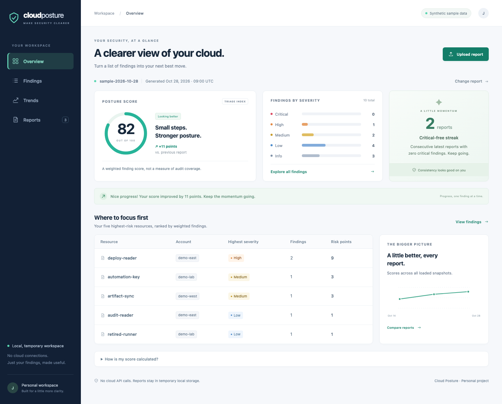

# Cloud Posture Dashboard

[](https://github.com/jayekwere/cloud-posture-dashboard/actions/workflows/ci.yml)
[](https://github.com/jayekwere/cloud-posture-dashboard/actions/workflows/container.yml)
[](LICENSE)

A personal, local-first Flask app that turns JSON security findings into a useful posture dashboard: a transparent score, severity counts, ranked resources, searchable findings, report comparisons, and filtered exports. It starts with three entirely synthetic snapshots, uses plain SVG charts and local assets, and never connects to a cloud account. A generic findings schema makes it useful on its own; an explicit auditor bridge contract provides a second input format without requiring another project.



## Quickstart

Requires **Python 3.12+** and Make. CI tests Python 3.12 and 3.14; the container uses Python 3.14.6.

```sh
git clone https://github.com/jayekwere/cloud-posture-dashboard.git
cd cloud-posture-dashboard
make run
```

Open **[http://127.0.0.1:8000](http://127.0.0.1:8000)**. `make run` creates a virtual environment, installs hash-locked dependencies and starts a loopback-only server with debugging disabled. The dashboard is populated immediately. Use `make run PORT=8080` if port 8000 is occupied. Stop with Ctrl+C.

For Docker Compose:

```sh
docker compose up --build
# Open http://127.0.0.1:8000
# Stop and remove the local instance:
docker compose down
```

The container runs as UID/GID **10001**, binds its published port to loopback, drops capabilities, prevents privilege escalation and uses a read-only root filesystem with a 64 MiB `/tmp` mount. It uses one Gunicorn worker with four threads. Reports and the session key are intentionally ephemeral; restarting the app or worker starts a new workspace. No credentials, environment file, external service or database is needed.

## Explore the app

- **Overview:** score and its formula, five severity counts, five riskiest account/resource pairs, loaded-report history and a critical-free streak. A higher score than the preceding snapshot gets a short encouragement.
- **Findings:** filter by severity, check type and account; search ids, titles, resources, descriptions and remediation; sort ascending/descending; open evidence/remediation details. Lists paginate at 50 rows.
- **Trends:** select an earlier and a later report to see new, resolved-in-report and still-open findings. Changes to severity or evidence retain the finding's identity.
- **Reports:** upload a `.json` file or load a built-in sample. Both extension/MIME checks and actual JSON/schema validation apply. Errors show a field path such as `$.findings[0].severity`.
- **Exports:** CSV or Markdown uses the same filters and sort as the table, exporting **all matching findings**, including rows beyond the current page.

Only normalized JSON is retained, under server-generated filenames in a private temporary directory. Each browser has an isolated workspace. Identical normalized uploads are deduplicated. A workspace holds at most 20 reports and expires after four idle hours; the process limits concurrent workspaces to 64. Use **Reports → Reset workspace** to remove your snapshots and start with the samples again. Loading is limited to fixed sample aliases; there is no arbitrary server-path loading endpoint.

## How the score works

```text
risk points = 20 × critical + 8 × high + 3 × medium + 1 × low + 0 × info
posture score = max(0, 100 − risk points)
```

The current sample has 0 critical, 1 high, 2 medium, 4 low and 3 informational findings: **100 − (8 + 6 + 4) = 82**. A resource's risk points are the sum of its findings' weights; ties use severity and deterministic account/resource order.

This is a **triage index based on finding volume**, not a compliance rating or a measure of scan coverage. An empty or incomplete report can score 100. The formula and these limits are also explained on the overview page.

The streak counts consecutive distinct **latest reports in generated-timestamp order** with zero critical findings, stopping at the first report with a critical finding. Re-uploading an identical normalized report does not increase it. The streak describes supplied inputs, not independently verified security.

## Findings JSON

The canonical [JSON Schema](posture/schemas/findings.schema.json) uses Draft 2020-12. This minimal report is valid:

```json
{
  "schema_version": "1.0",
  "report_id": "synthetic-example",
  "generated_at": "2026-10-28T09:00:00Z",
  "source": "synthetic-demo",
  "findings": [
    {
      "id": "demo-001",
      "severity": "high",
      "check_type": "wildcard-actions",
      "account": "demo-east",
      "resource": "demo:role/example-reader",
      "title": "Example reader allows broad actions",
      "description": "A synthetic statement contains a wildcard.",
      "evidence": {"synthetic": true, "actions": ["demo:Read*"]},
      "remediation": "Replace the wildcard with explicit read actions."
    }
  ]
}
```

Required report fields: `schema_version`, `report_id`, `generated_at`, `findings`. `source` is optional. Required finding fields: `id`, `severity`, `check_type`, `account`, `resource`, `title`. Description, evidence and remediation are optional. Severity is one of `critical`, `high`, `medium`, `low`, `info`; timestamps must be RFC 3339 with a timezone. Account/resource values are opaque labels—no account lookup occurs.

Unknown fields, duplicate JSON object keys, non-finite numbers, invalid Unicode values and duplicate finding identities are rejected. Limits: 1 MiB uploaded JSON and normalized storage, 2,000 findings, nesting depth 20 and 40,000 JSON values, plus per-field string limits in the schema. Errors display up to five schema failures. Evidence remains data; embedded `$ref` strings do not resolve remote schemas.

### Auditor bridge

The optional [auditor bridge schema](posture/schemas/auditor.schema.json) is an **included example contract**, with a synthetic [fixture](samples/auditor-bridge.json). It requires `tool: "iam-least-privilege-auditor"`, `generated_at` and `findings`. There is no existing external auditor dependency or verified upstream output format being claimed.

| Bridge field | Canonical field |
| --- | --- |
| `check_id` | `check_type` |
| `account_id` | `account` |
| `resource_arn` or `principal_arn` | `resource` |
| Upper/lowercase severity | Lowercase severity |
| `recommendation` or `remediation` | `remediation` |
| Optional `id` | Preserved, or generated from account/resource/check |

When absent, `report_id` is derived from the timestamp and title defaults to the check id. Other accepted fields and limits are in the bridge schema. A future auditor can emit this contract, or a different adapter can normalize its output without changing the scoring or views.

### Comparison semantics

Finding identity is `(account, resource, check_type, id)`. “New” appears only in the later input; “resolved in report” appears only in the earlier input; “still open” appears in both, using the later evidence/severity. **Absence is not proof of remediation.** Compare reports with equivalent scope; changed ids or account naming can look like new/resolved findings.

## Security design

- App factory, Flask-WTF CSRF protection on **every POST**, Jinja2 HTML autoescaping and escaped evidence display. No report-supplied HTML, templates, code or remediation commands are executed.
- CSP allows scripts/styles/images only from the app, with no inline-script/style exceptions. CSS, JavaScript, icons and SVG charts are local; no CDN, analytics, external fonts or browser cloud requests.
- Security headers include `nosniff`, frame denial, no-referrer, a restrictive permissions policy and no-store caching. Host headers default to localhost/loopback only. Cookies are HttpOnly and SameSite=Strict; only opaque identifiers and small status messages are stored in the signed cookie.
- A cryptographically random, per-worker secret is generated in memory. No fixed/default signing secret is shipped. For an actual HTTPS deployment, `POSTURE_HTTPS=1` enables Secure cookies; HSTS is added when the WSGI request is HTTPS. No automatic proxy-header trust is enabled.
- Uploads are bounded before parsing. Filenames never become paths. Validated reports are stored with owner-only permissions using atomic replacement; interrupted writes do not leave a partially valid report. CSV formula-like cells are prefixed with an apostrophe; Markdown exports escape HTML and formatting syntax.
- Minimal, digest-pinned Python Alpine image; available OS updates applied during the build; hash-locked Python dependencies; no pip or login shell for the runtime user. Compose adds a read-only root, no-exec temporary storage, memory/process/CPU bounds and capability restrictions.
- CI uses read-only repository permissions, full-SHA-pinned actions, disabled checkout credential persistence and a checksum-pinned Trivy binary. The image gate requires OS **and** Python inventories and fails on **every high/critical vulnerability**, fixed or unfixed. Empty/incomplete scans fail; no repository ignore file is used.

### Known limitations

This is a **personal local app**, not a public or multi-tenant service. It has no authentication, authorization roles, encrypted storage, durable history or independent assessment of findings. Browser isolation is not protection from the host administrator or another process with the same OS permissions. Temporary files are not securely erased; abrupt termination can leave them until normal temporary-directory cleanup. Container temporary storage is removed with the container.

The worker-local secret/store intentionally support one worker. Worker replacement loses the workspace; do not increase the worker count without introducing shared session/state design. A public deployment needs authentication, TLS, a deliberate proxy/host configuration, persistent key/state management and operational review. Security headers are defense in depth, not access control.

Uploaded remediation is untrusted advice. Spreadsheet applications vary in CSV interpretation; review untrusted exports before opening them. Scores and trends cannot prove security, fix completion or coverage. Vulnerability results are dated snapshots; package repositories and scanner databases change. OS upgrades make builds current rather than bit-for-bit reproducible. Refresh pins, scans and evidence regularly.

## Development and verification

```sh
make install
make check                 # ruff, strict mypy, pytest + branch coverage
python3 scripts/check_container.py --image cloud-posture-dashboard:local
```

Build the image before running the container check. It starts an isolated loopback-only container, verifies restrictions/HTTP behavior, and removes it afterward. No cloud resources or services are used.

Tests cover parsing, schema errors and limits, scoring, ranking, identity-based diffs, streaks, filters, routes, CSRF, XSS escaping, browser-session isolation, upload/temporary-store limits, exports and fail-closed scanner gating. Coverage must remain at least **85%**. See the [dated local verification record](docs/verification.json); hosted CI retains source-bound coverage and image/runtime scan artifacts for 14 days.

Sample files live in [`samples/`](samples); matching packaged copies are checked by tests so local and container demos stay consistent. Runtime dependencies are hash-locked in `requirements.lock`, and development/build tooling in `requirements-dev.lock`. Python 3.12/3.14 CI verifies the install path. To update dependencies deliberately, use a current isolated pip-tools installation to regenerate the lockfiles with hashes, then rerun all checks and rebuild/scan the image.

License: [MIT](LICENSE).
